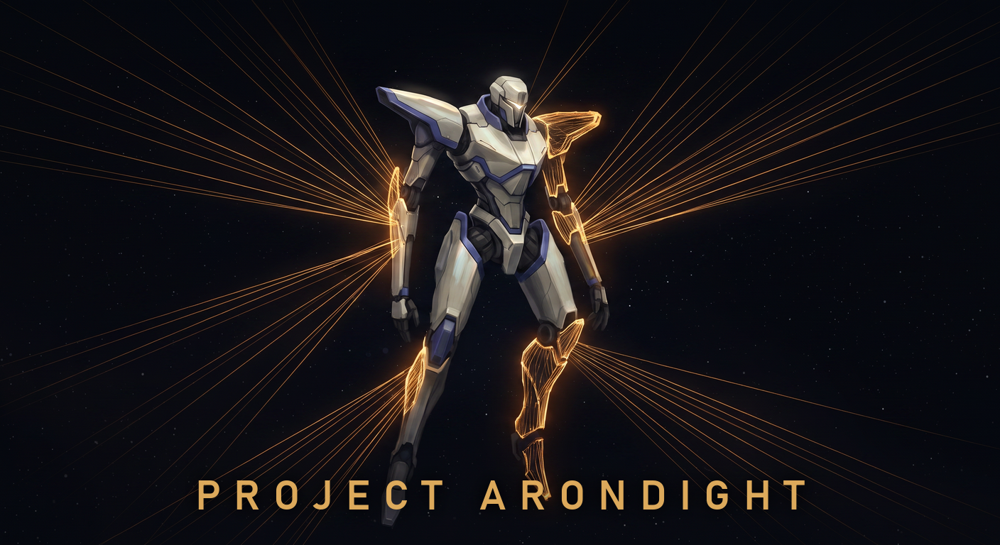
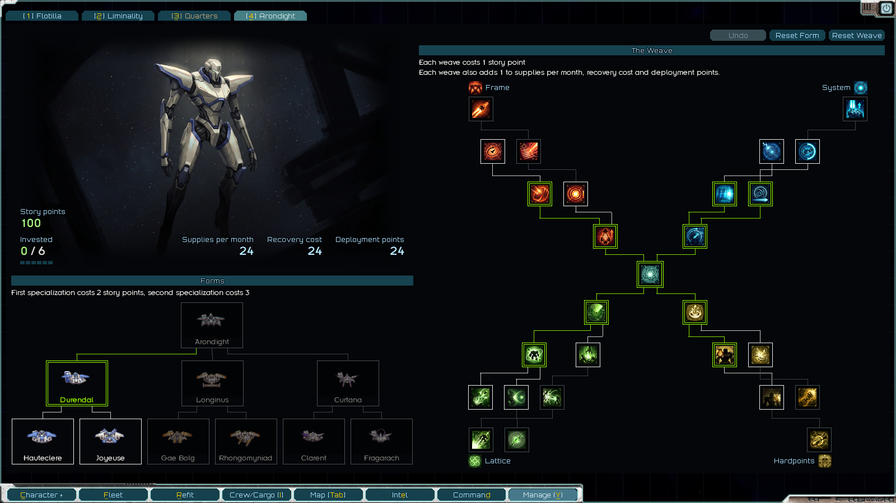
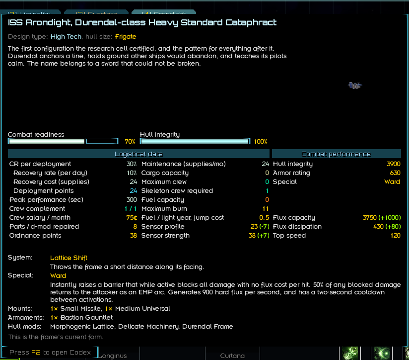
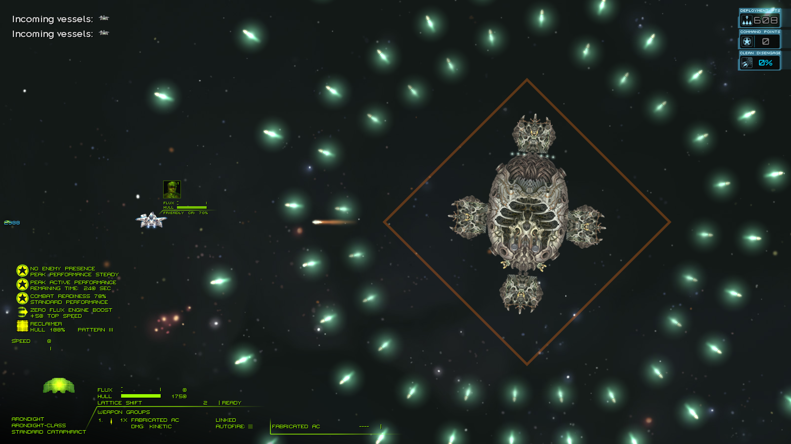
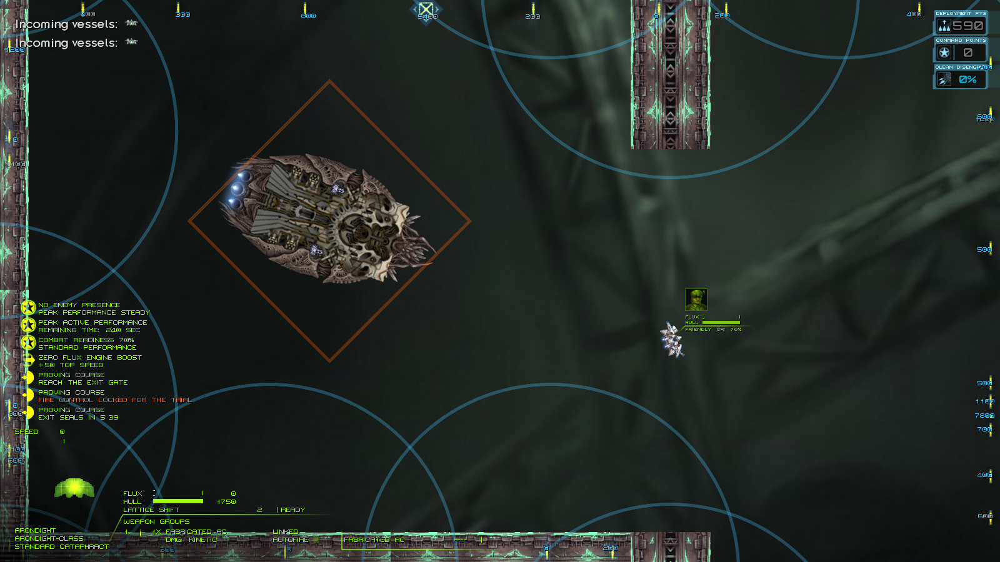

# Project Arondight
> The lattice grows.

A crewed mech super-frigate, recovered from a derelict research habitat, and the missions around it. The mech can be upgraded through a variety of missions and skill tree choices.

Spoilers for [THREAT].

No required dependencies. Optional integration with Arma Armatura and LunaLib. Can be added to existing saves. Full survival-mode support.

[Forum link](https://fractalsoftworks.com/forum/index.php?topic=35861.0)

## Screenshots

